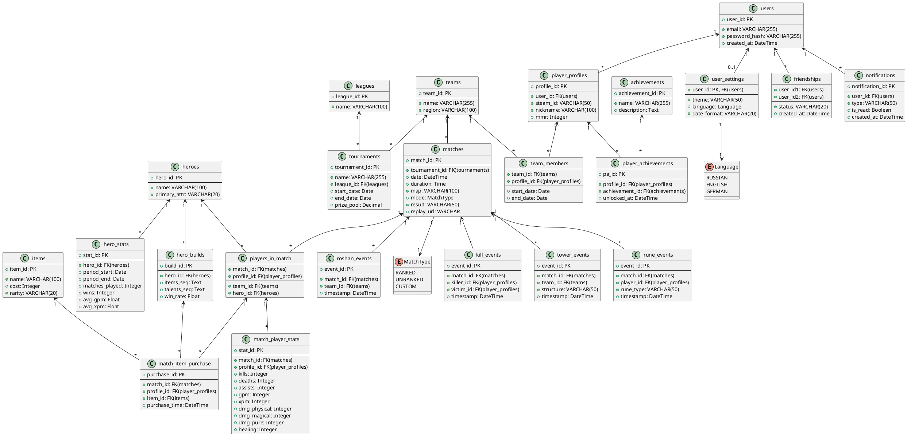

# DotaBuff DB

Отказоустойчивая база данных для сервиса статистики матчей Dota 2 (аналог DotaBuff):
PostgreSQL-кластер с автоматическим переключением мастера, версионируемые миграции,
генерация тестовых данных, мониторинг производительности запросов и регулярные бэкапы.
Вся инфраструктура поднимается одной командой через Docker Compose.

> Учебный проект по курсу баз данных, Университет ИТМО.

## Архитектура

```
              ┌──────────── etcd1 / etcd2 / etcd3 (DCS) ────────────┐
              │                                                      │
 клиенты ──► HAProxy :5000 (primary) / :5001 (replicas) ──► Patroni 1 │ 2 │ 3 (PostgreSQL)
                                    │
     ┌──────────────┬───────────────┼────────────────┬─────────────────┐
     ▼              ▼               ▼                ▼                 ▼
  initdb  ──►   Flyway  ──►      seeder         simulator ──►    db_backup (cron + pg_dump)
 (создание БД) (миграции)  (тестовые данные,  (нагрузочные запросы,
                            роли аналитиков)    метрики Prometheus)
                                                     │
                       postgres-exporter ──► Prometheus ──► Grafana
```

| Компонент | Назначение |
|---|---|
| **Patroni × 3 + etcd × 3** | HA-кластер PostgreSQL с автоматическим failover |
| **HAProxy** | единая точка входа: `:5000` — запись в мастер, `:5001` — чтение с реплик |
| **Flyway** | миграции схемы `V1`–`V8` |
| **seeder** | генерация связанных тестовых данных, создание ролей аналитиков |
| **simulator** | периодически выполняет тяжёлые запросы и отдаёт время выполнения в Prometheus |
| **postgres-exporter, Prometheus, Grafana** | мониторинг БД и дашборд времени выполнения запросов |
| **db_backup** | бэкапы `pg_dump` по расписанию cron с ротацией старых копий |

## Схема данных

23 таблицы (миграции `V2`–`V7`), создание роли приложения (`V1`) и индексы (`V8`):

- **Пользователи**: `users`, `user_settings`, `friendships`, `notifications`, `player_profiles`
- **Турниры и команды**: `leagues`, `tournaments`, `teams`, `team_members`
- **Матчи и события**: `matches`, `kill_events`, `tower_events`, `rune_events`, `roshan_events`
- **Герои и достижения**: `heroes`, `hero_builds`, `hero_stats`, `achievements`, `player_achievements`
- **Статистика игроков**: `players_in_match`, `match_player_stats`, `items`, `match_item_purchase`

Полная ER-диаграмма — в [`dotabuff.uml`](dotabuff.uml) и в разделе требований ниже.

## Стек

PostgreSQL · Patroni · etcd · HAProxy · Flyway · Python (psycopg2) · Prometheus · Grafana · Docker Compose

## Запуск

1. Соберите образ Patroni (используется официальный демо-образ из репозитория Patroni):
   ```bash
   git clone https://github.com/patroni/patroni.git
   docker build -t patroni patroni/
   ```
2. Создайте файлы с переменными окружения:
   ```bash
   cd DataBaseDotaBuff
   cp .env.example .env
   cp patroni.env.example patroni.env
   ```
   и задайте свои пароли.
3. Поднимите всё окружение:
   ```bash
   docker compose up -d
   ```

| Сервис | Адрес |
|---|---|
| PostgreSQL (мастер, через HAProxy) | `localhost:15000` |
| PostgreSQL (реплики) | `localhost:15001` |
| Grafana | http://localhost:3000 |
| Prometheus | http://localhost:9090 |
| Метрики симулятора | http://localhost:8000 |

## Структура репозитория

```
DataBaseDotaBuff/
├── docker-compose.yml
├── migrations/      Flyway-миграции V1–V8
├── seeds/           генерация тестовых данных и ролей аналитиков
├── simulator/       нагрузочные запросы + экспорт метрик
├── backup/          скрипт резервного копирования
├── prometheus/      конфигурация Prometheus
└── grafana/         provisioning источников данных и дашборда
dotabuff.uml         ER-диаграмма
```

## Функциональные требования

### Управление пользователями и социальные связи  
- Пользователь может зарегистрироваться через e-mail/пароль или Steam.  
- Пользователь может войти в систему и восстановить пароль по e-mail.  
- Пользователь может редактировать свой профиль: никнейм, e-mail, пароль и аватар.  
- Пользователь может настраивать тему, язык и дату.  
- Пользователь может добавлять и удалять друзей, просматривать их статус.  

### Уведомления  
- Пользователь может получать уведомления о событиях (новые матчи, друзья, достижения).  
- Пользователь может просматривать список уведомлений и помечать их как прочитанные.  

### Турниры и команды  
- Пользователь может просматривать список лиг и турниров с датами и призовым фондом.  
- Пользователь может просматривать команды с указанием их региона и названия.  
- Пользователь может просматривать состав команды и периоды, когда конкретный игрок входил в состав команды.  

### Матчи и ключевые события  
- Пользователь может просматривать список матчейи их основный характеристики: дата, длительность, карта, режим, результат, ссылка на реплей. 
- Пользователь может просматривать матч более подробно, а именно основные моменты игры:  
  - убийства: кто убил, кого и когда
  - разрушения строений: какая команда, какое строение и когда
  - подбор рун: кто, какую руну и когда подобрал 
  - убийства Рошана: какая команда и когда  
- Пользователь может просматривать участников матча и кто на каком герое играл
- Пользователь может просматривать сводную статистику игрока в матче: K/D/A, GPM, XPM, урон по разным типам, лечение.  
- Пользователь может просматривать историю покупок предметов: что и когда куплено.  

### Герои и сборки  
- Пользователь может просматривать список героев: имя и основной атрибут
- Пользователь может изучать топ-сборки предметов и талантов с их процентом побед в матчах 
- Пользователь может просматривать агрегированную статистику конкретного героя за период: количество матчей, побед, средние GPM/XPM 

### Достижения  
- Пользователь может просматривать список возможных достижений: название и описание
- Пользователь может просматривать свои полученные достижения с датами получения 

### Поиск и фильтрация данных  
- Пользователь может искать игроков по нику или Steam ID
- Пользователь может искать матчи по дате, турнирам и героям
- Пользователь может сортировать матчи по длительности, результату и другим параметрам  

### Дополнительная аналитика и прогнозы  
- Платформа может анализировать данные матчей и выдавать прогнозы на основе текущих трендов, статистики героев и игроков.  
- Пользователь может получать рекомендации по сборкам и стратегиям на основе актуальных трендов.  

### Интеграция с внешними API  
- Система интегрируется с Dota 2 API для автоматического получения информации о матчах, игроках и статистике.  
- Система может автоматически обновлять данные при появлении новых публичных обновлений или по расписанию.  

### Интерфейс администрирования  
- Администратор может удалять нарушающий правила контент.  
- Администратор может блокировать и удалять неактивные аккаунты.  
- Администратор может редактировать информацию о турнирах и событиях.  

